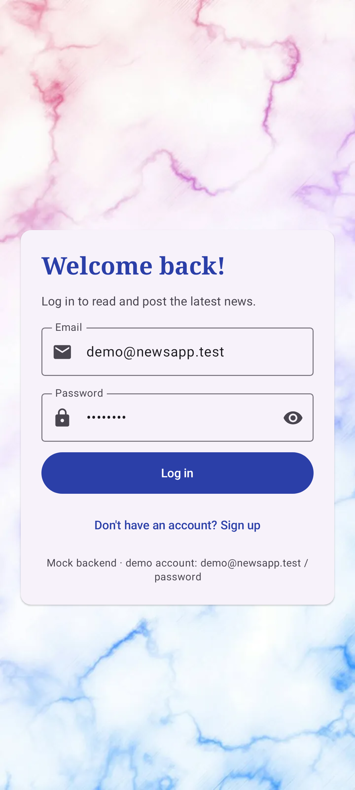
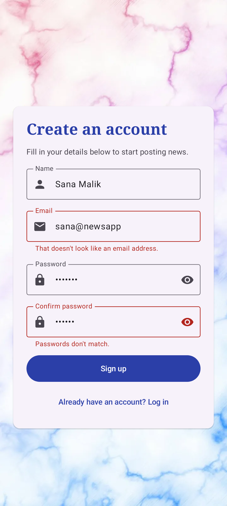
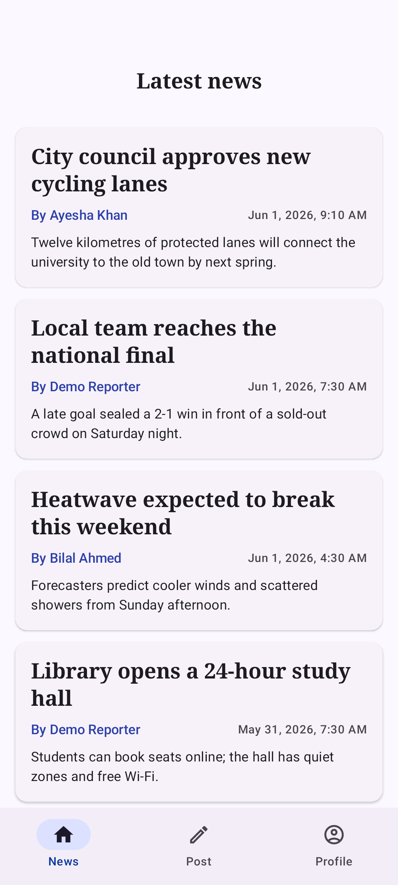
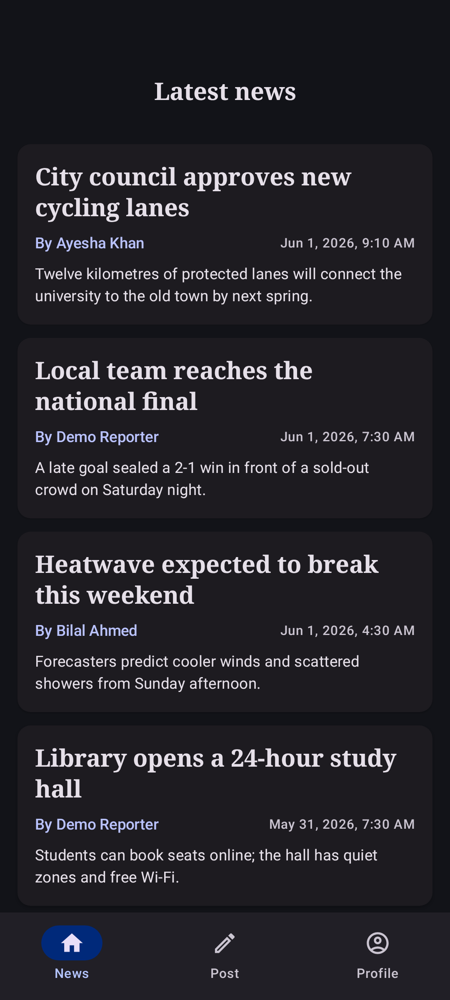
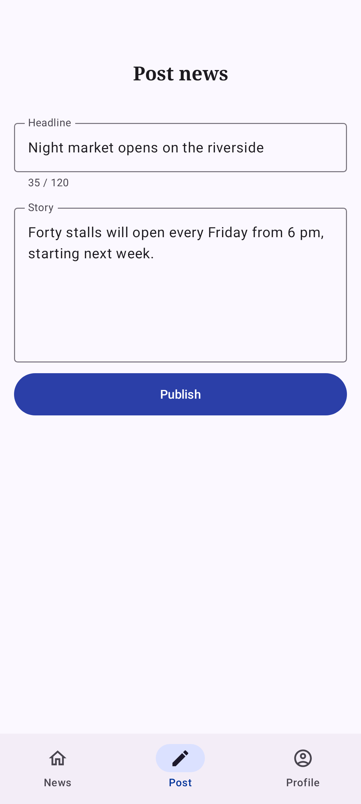
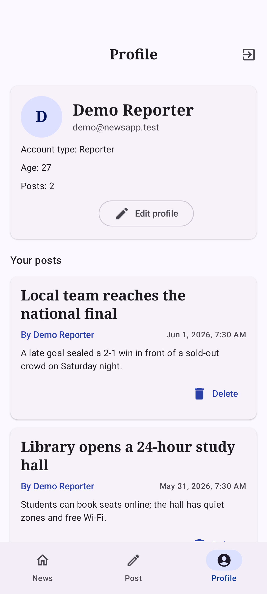
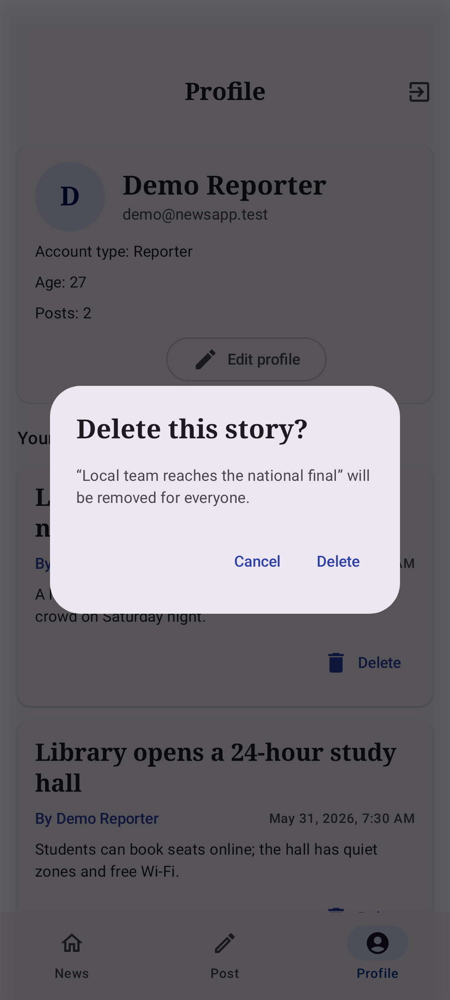
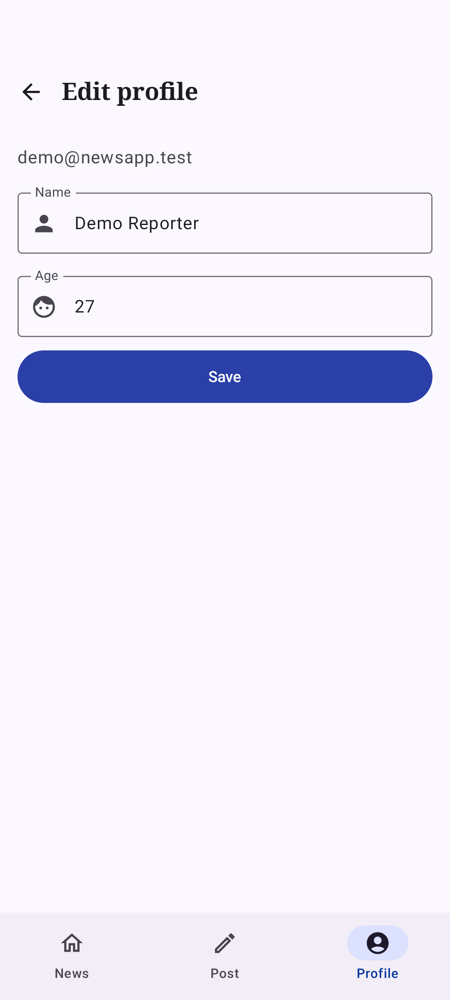
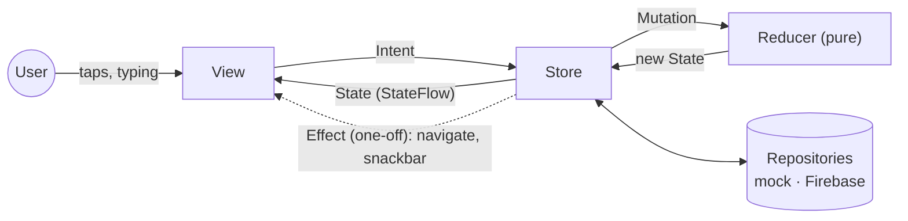

# News App: an MVI example in Jetpack Compose

Read the latest local news, post your own stories, and manage your profile.

This project shows **Model–View–Intent (MVI)** done properly in a modern Android app (Jetpack
Compose, Navigation 3, Hilt, coroutines and Firebase). Its sister project,
[WeatherApp](https://github.com/ZENSH1/WeatherApp), builds a similar app with **MVC**, so you can
compare the two side by side.

The Android project is in the [`NewsApp/`](NewsApp) folder. It used to be called FireNotesApp.

## Screenshots

| Splash | Log in | Sign up (invalid input) | News feed | Dark theme |
|---|---|---|---|---|
|  |  |  |  |  |

| Post a story | Profile | Delete a story | Edit profile |
|---|---|---|---|
|  |  |  |  |

These are the reference images of the [screenshot tests](NewsApp/app/src/screenshotTest), so they
are rendered from the code, not captured by hand. In MVI every screen is a function of its state,
so each screenshot is just a state, such as `SignUpState` with two field errors.

---

## 1. What is MVI?

MVI keeps everything a screen shows in **one immutable state object**, and only lets that state
change in **one place**. User actions come in as **intents**, and the new state comes out.

| Part | What it is | Example (login screen) |
|---|---|---|
| **State** | One immutable object with everything the screen shows | [`LoginState`](NewsApp/app/src/main/java/com/xs/newsapp/feature/login/LoginContract.kt) (email, password, errors, `isSubmitting`) |
| **Intent** | Something the user wants to do. The only input. | `LoginIntent.EmailChanged`, `LoginIntent.Submit` |
| **Mutation** | A fact produced while handling an intent | `LoginMutation.SubmissionStarted` |
| **Reducer** | A pure function `(State, Mutation) -> State`. The *only* place state changes. | `LoginReducer` |
| **Effect** | A one-off event that must not replay after rotation | `LoginEffect.ShowError`, `LoginEffect.NavigateToSignUp` |
| **Store** | Runs the loop: takes intents, does async work, applies mutations, sends effects | [`LoginViewModel`](NewsApp/app/src/main/java/com/xs/newsapp/feature/login/LoginViewModel.kt), built on [`MviViewModel`](NewsApp/app/src/main/java/com/xs/newsapp/core/mvi/MviViewModel.kt) |
| **View** | Renders the state and turns gestures into intents. No logic. | [`LoginContent`](NewsApp/app/src/main/java/com/xs/newsapp/feature/login/LoginScreen.kt) |

Data flows one way, round in a circle:



Every screen has the same four types in a `…Contract.kt` file, and its store extends one small base
class (simplified here):

```kotlin
abstract class MviViewModel<S, I, M, E>(initialState: S, private val reducer: Reducer<S, M>) : ViewModel() {
    val state: StateFlow<S>        // the single source of truth, rendered by the View
    val effects: Flow<E>           // one-off events, each delivered once
    fun onIntent(intent: I)        // the only way in
    protected fun mutate(mutation: M) { _state.update { reducer.reduce(it, mutation) } }
}
```

### Walk-through: logging in

```text
LoginContent (View)     user types an email
  └─▶ onIntent(EmailChanged("demo@newsapp.test"))
        └─▶ mutate(EmailUpdated)  ─▶ LoginReducer: email = "…", emailError = null  ─▶ View redraws
LoginContent (View)     user taps "Log in"
  └─▶ onIntent(Submit)
        ├─ invalid input?  mutate(ValidationFailed)          ─▶ errors appear under the fields
        ├─ mutate(SubmissionStarted)                          ─▶ the button shows a spinner
        ├─ authRepository.signIn(…)
        │    ├─ fails:  sendEffect(ShowError(InvalidCredentials))  ─▶ one snackbar, never replayed
        │    └─ works:  the session becomes SignedIn
        │               └─▶ AppViewModel: AppState.destination = Main  ─▶ the feed and tabs appear
        └─ mutate(SubmissionFinished)                         ─▶ the button is enabled again
```

Notice that the login screen never navigates to the feed. Signing in changes the **session**, and
the app shell ([`AppViewModel`](NewsApp/app/src/main/java/com/xs/newsapp/app/AppViewModel.kt)) is
just another MVI store whose state says which part of the app is shown: `Splash`, `Auth` or
`Main`. Logging out works the same way in reverse.

### State or effect?

- Anything the screen should still show after rotation is **state**. Errors under fields, spinners,
  and the "delete this story?" dialog (`ProfileState.articlePendingDeletion`) are all state.
- Anything that should happen **once** is an **effect**: "show this snackbar", "go back". Effects go
  through a `Channel`, so each one is handled exactly once. They are collected with
  [`ObserveEffects`](NewsApp/app/src/main/java/com/xs/newsapp/core/mvi/ObserveEffects.kt) only while
  the screen is started.

## 2. Why MVI here, and when to use it

**Why it fits this app.** Most screens are forms with validation, asynchronous submissions,
loading and error states, and one-off events. MVI puts all of that in one immutable state and
one pure reducer per screen, so there is never a question of which flag is out of date.

**Benefits**
- **One source of truth per screen.** The View is a pure function of the state. Previews and
  screenshot tests are just states.
- **Predictable.** State changes only in the reducer, and only in response to a known intent or
  mutation. Logging every intent and mutation would give you a full replay of a session.
- **Testable at every level.** Reducers are pure functions, tested without coroutines or Android.
  Stores are tested with fake repositories. Views are tested by feeding them states.
- **One-off events done right.** Effects never replay after rotation, unlike a "show error" flag.
- **Survives configuration changes.** The store is a `ViewModel` scoped to its screen.

**Drawbacks**
- **Boilerplate.** Four types per screen (state, intent, mutation, effect) before writing any logic.
- **Learning curve.** The extra indirection can feel heavy for a trivial screen.
- **Big states** need care, such as stable keys in lists, so recomposition stays cheap.

**Rule of thumb:** reach for MVI when a screen has lots of interacting UI state and asynchronous
events. For a small screen with rich domain rules, MVC or MVVM can be simpler.

### MVC (WeatherApp) vs MVI (News App)

| | [WeatherApp](https://github.com/ZENSH1/WeatherApp) (MVC) | News App (MVI) |
|---|---|---|
| Where state lives | Several observable properties on a Model | One immutable `State` per screen |
| Who changes it | Model methods, called by the Controller | Only the reducer |
| Input | Controller methods (`onSearchSubmitted(text)`) | Intent objects (`onIntent(Submit)`) |
| One-off events | No natural home | `Effect`s |
| Lifecycle | App-scoped Model singleton, no ViewModel | One store (ViewModel) per screen |
| Testing focus | Model and Controller rules | Reducers, stores, and View states |

## 3. Navigation is state too

- **Which flow** (splash, logged out, logged in) is `AppState.destination`, derived from the
  session. [`NewsApp.kt`](NewsApp/app/src/main/java/com/xs/newsapp/app/NewsApp.kt) crossfades
  between them.
- **Inside a flow** it's [Navigation 3](https://developer.android.com/guide/navigation/navigation-3):
  back stacks are plain lists of `@Serializable` keys that you own.
  - [`AuthNavigation`](NewsApp/app/src/main/java/com/xs/newsapp/navigation/AuthNavigation.kt):
    Login, with Sign up pushed on top.
  - [`MainNavigation`](NewsApp/app/src/main/java/com/xs/newsapp/navigation/MainNavigation.kt): a
    bottom bar with one back stack per tab
    ([`NavigationState`](NewsApp/app/src/main/java/com/xs/newsapp/navigation/NavigationState.kt) +
    [`Navigator`](NewsApp/app/src/main/java/com/xs/newsapp/navigation/Navigator.kt)), so each tab
    remembers where you were. Back returns to the News tab before leaving the app.
- Every screen gets its own `ViewModelStore`, cleared when the screen is popped or its flow is
  left. Logging out throws away every logged-in screen's state.
- Screens ask to navigate with effects (`NavigateToEditProfile`). The navigation code turns them
  into back-stack changes.

## 4. Project structure

```text
NewsApp/app/src/
├── main/java/com/xs/newsapp/
│   ├── MainActivity.kt, NewsApplication.kt
│   ├── app/                  app shell: AppState/AppIntent/AppReducer, AppViewModel, NewsApp()
│   ├── core/
│   │   ├── mvi/              MviViewModel (the store), Reducer, ObserveEffects
│   │   ├── validation/       pure input rules (email, password, age, lengths)
│   │   └── ui/               theme and shared components (form fields, article card, …)
│   ├── data/
│   │   ├── model/            User, Session, Article, UserProfile, BackendError
│   │   └── repository/       AuthRepository, NewsRepository, ProfileRepository (interfaces)
│   ├── feature/              one package per screen:
│   │   └── login/            LoginContract.kt (State, Intent, Mutation, Effect, Reducer)
│   │                         LoginViewModel.kt (store), LoginScreen.kt (View)
│   │                         … same for signup, feed, publish, profile, editprofile, splash
│   └── navigation/           routes, Navigation 3 hosts, per-tab back stacks
├── mock/                     in-memory backend with demo data (default flavor)
├── prod/                     Firebase Authentication + Cloud Firestore
├── test/                     JVM tests: reducers, stores, validation, navigator, Robolectric Views
├── screenshotTest/           screenshot tests (Compose previews rendered on the JVM)
└── screenshotTestMockDebug/  their reference images, also used in this README
```

## 5. Backends: `mock` and `prod` flavors

The stores only see the repository interfaces, so the backend is a build choice, not a code change.

| Build variant | Backend | Needs |
|---|---|---|
| `mockDebug` (default) | In-memory, seeded with stories and accounts, with simulated network latency. Resets when the app restarts. | Nothing |
| `prodDebug` | Firebase Authentication (email/password) and Cloud Firestore | The Firebase project in `app/google-services.json` |

Demo accounts in the mock backend: **`demo@newsapp.test` / `password`**, plus
`ayesha@newsapp.test` and `bilal@newsapp.test` with the same password. The login screen shows this
hint in the mock flavor only.

The prod backend uses the `Users` and `News` collections with the same field names as earlier
versions of the app, so existing data keeps working.

> **Note on the package name:** the code lives in `com.xs.newsapp`, but the `applicationId` is
> still `com.xs.firenotesapp`. That id is the app's identity on devices and in Firebase, and it must
> match the app registered in `google-services.json`. To change it, register the new id in the
> Firebase console and replace `app/google-services.json`.

## 6. Build, run, test

Requirements: an Android Studio version that supports AGP 9.4, JDK 17+, Android SDK 37.

```bash
cd NewsApp
./gradlew :app:installMockDebug                 # run with the in-memory backend
./gradlew :app:testMockDebugUnitTest            # 55 JVM tests (also run for prodDebug)
./gradlew :app:validateMockDebugScreenshotTest  # compare the UI with the reference screenshots
./gradlew :app:updateMockDebugScreenshotTest    # re-record them after an intended UI change
```

What the tests cover:
- **Reducers**: pure functions, no coroutines (`LoginReducerTest`, plus reducer cases in the store tests).
- **Stores**: every screen's ViewModel against hand-written fake repositories. They check state,
  effects, and backend calls (`LoginViewModelTest`, `ProfileViewModelTest`, …).
- **App shell and navigation**: `AppViewModelTest` (splash, logged out, logged in) and
  `NavigatorTest` (tabs, back stacks, Back).
- **Views**: Robolectric Compose tests feed a state and check the intents sent
  (`LoginContentTest`, `ProfileContentTest`).
- **Screenshots**: nine screens and states, light and dark.

Screenshot tests use Google's Compose Preview Screenshot Testing tool through its standalone
`com.android.compose.screenshot` plugin. That setup is deprecated in favour of AGP test suites,
which need AGP 9.5.0-alpha03 or newer; this project stays on stable AGP 9.4 for now.

## 7. Android best practices applied

Following the official [Android skills](https://github.com/android/skills) and Google's
architecture guidance:

- **Build** (`agp-9-upgrade`): AGP 9.4 with built-in Kotlin (no `kotlin-android` plugin), Gradle
  9.8, a version catalog, KSP instead of kapt, configuration cache, and R8 with resource shrinking
  for release.
- **Navigation 3** (`navigation-3`): type-safe `@Serializable` keys, the multiple-back-stacks
  recipe, a ViewModel store per entry, and conditional (logged-in or not) navigation driven by state.
- **Edge-to-edge** (`edge-to-edge`): `enableEdgeToEdge()`, `adjustResize`, `WindowInsets.safeDrawing`
  for forms, insets in lists' `contentPadding`, and `consumeWindowInsets` under the bottom bar.
  Navigation bar contrast enforcement is off, because the app has a bottom bar.
- **Compose** (`jetpack-compose-performance`): stateless `…Content` composables with previews,
  stable `key` + `contentType` in lazy lists, `collectAsStateWithLifecycle`, no side effects
  during composition, and effects collected only while the screen is started.
- **Testing** (`testing-setup`): fakes over mocks, JVM tests for logic, Robolectric for Compose UI
  tests, and screenshot tests for the look of each screen.
- **Data**: repositories expose `Flow`s and main-safe suspend functions, and translate Firebase
  exceptions into a small `BackendError` type. Firestore updates arrive in real time through
  `callbackFlow`. Account setup finishes even if the sign-up screen closes as soon as the user is
  signed in.
